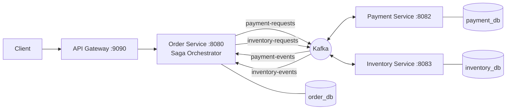
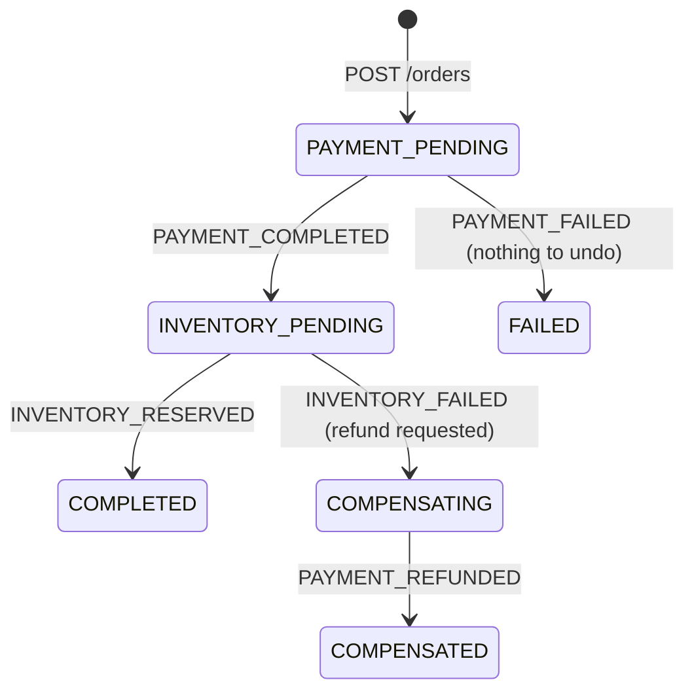

# Distributed Order Processing System (Orchestrated Saga)

Spring Boot microservices that process an order across **Order -> Payment -> Inventory** using an
**orchestrated Saga**, Kafka events, compensating transactions (refund), crash recovery, Eureka, Spring Cloud Gateway,
Resilience4j, Zipkin tracing and Docker.

## Architecture


Side channels (not part of the request flow): every service registers in **Eureka (:8761)** and reports trace spans to **Zipkin (:9411)**.

Rules: Payment and Inventory never call each other. Only Order Service decides the next step. Each service owns its database.

## Saga state machine



## Kafka topics and events

| Topic | From -> To | eventType |
|---|---|---|
| `payment-requests` | Order -> Payment | `PAYMENT_REQUESTED`, `PAYMENT_REFUND_REQUESTED` |
| `payment-events` | Payment -> Order | `PAYMENT_COMPLETED`, `PAYMENT_FAILED`, `PAYMENT_REFUNDED` |
| `inventory-requests` | Order -> Inventory | `INVENTORY_RESERVE_REQUESTED` |
| `inventory-events` | Inventory -> Order | `INVENTORY_RESERVED`, `INVENTORY_FAILED` |

## Run option A: everything in Docker (one command)

```bash
cp .env.example .env          # then edit .env and set DB_PASSWORD
docker compose up --build
```
First build takes a few minutes. Check http://localhost:8761 : API-GATEWAY, ORDER-SERVICE, PAYMENT-SERVICE, INVENTORY-SERVICE must be UP.

## Run option B: services in your IDE (good for debugging)

1. Start only the infrastructure: `docker compose up mysql kafka zipkin` (MySQL is on **localhost:3307** in this mode, Kafka on **localhost:9092**).
2. Set environment variables for each service run configuration:
   `DB_PASSWORD=<your .env password>`, and `DB_URL=jdbc:mysql://localhost:3307/<order_db|payment_db|inventory_db>?createDatabaseIfNotExist=true`
   (If you use your own local MySQL on 3306 instead, you only need `DB_PASSWORD`.)
3. Start in this order: `service-registry` -> `api-gateway` -> `order-service`, `payment-service`, `inventory-service`.

## Swagger UIs
Order http://localhost:8080/swagger-ui.html | Payment http://localhost:8082/swagger-ui.html | Inventory http://localhost:8083/swagger-ui.html

## Test scenarios (all through the gateway on :9090)

**1. Happy path** (set `PAYMENT_FAILURE_RATE=0` so payment always succeeds)
```bash
curl -X POST http://localhost:9090/orders -H "Content-Type: application/json" \
  -d '{"productId":"PROD-1","quantity":2,"amount":199.99}'
# copy "orderId" from the response, wait 2 seconds, then:
curl http://localhost:9090/orders/<orderId>
# expect orderStatus=CONFIRMED, sagaStatus=COMPLETED
curl http://localhost:9090/inventory/PROD-1      # stock went 100 -> 98
```

**2. Payment failure** (set `PAYMENT_FAILURE_RATE=1`): final state `FAILED` / `FAILED`. No compensation, nothing to undo.

**3. Compensation, the key demo** (`PAYMENT_FAILURE_RATE=0`; PROD-2 has only 5 in stock)
```bash
curl -X POST http://localhost:9090/orders -H "Content-Type: application/json" \
  -d '{"productId":"PROD-2","quantity":10,"amount":500.00}'
curl http://localhost:9090/orders/<orderId>               # COMPENSATED / COMPENSATED
curl http://localhost:9090/payments/order/<orderId>       # status REFUNDED
curl http://localhost:9090/inventory/PROD-2               # still 5, untouched
```

**4. Idempotent API**: send the same request twice with `-H "Idempotency-Key: abc-123"` -> same order returned, only one created.

**5. Crash recovery**: stop `payment-service`, create an order (stays `PENDING / PAYMENT_PENDING`), start payment again.
Within ~60-90 s the recovery job re-sends the request and the order completes by itself.
(To see it faster, set `saga.recovery.stuck-after-seconds=15`.)

**6. Circuit breaker**: stop `order-service`, call `POST /orders` through the gateway several times -> fast `503` JSON from `/fallback/orders`.

**7. Tracing**: open http://localhost:9411 -> Run Query: one trace shows gateway -> order -> payment -> inventory, across Kafka.

## Run the unit tests
```bash
cd order-service && mvn test
cd payment-service && mvn test
cd inventory-service && mvn test
```

## Design decisions (interview talking points)
- **Orchestration over choreography**: one coordinator (Order Service) makes every decision; easy to follow and debug.
- **Idempotent consumers**: Kafka delivers at least once. Order checks the expected saga state; Payment has a unique `sagaId`; Inventory has a unique `sagaId` plus a row lock (`SELECT ... FOR UPDATE`) to stop overselling.
- **Compensation vs failure handling**: payment failed = nothing to undo; inventory failed after payment = refund (compensation).
- **Send after commit**: Kafka messages are published only after the DB transaction commits.
- **Crash recovery**: saga state in MySQL + a scheduled job that re-sends stuck requests, with a retry limit and a safe give-up rule.
- **Database per service**, **Kafka message key = orderId** (ordering per order), **Eureka + Gateway** for discovery/routing.

## Known limitations (honest "what's missing for real production")
- No Transactional Outbox: a crash between DB commit and Kafka send can lose a message (the recovery job covers it).
- Single Kafka broker, single MySQL server, single instance per service (no high availability).
- The recovery job would run on every Order Service instance (needs a distributed lock such as ShedLock when scaled).
- No authentication/JWT, no centralized logging/metrics dashboards, no CI/CD, no load testing.
- `ddl-auto=update` is used for convenience; production should use Flyway/Liquibase migrations.
- Failed Kafka messages are retried then skipped; a dead-letter topic would be the next step.
- The payment provider is simulated.
